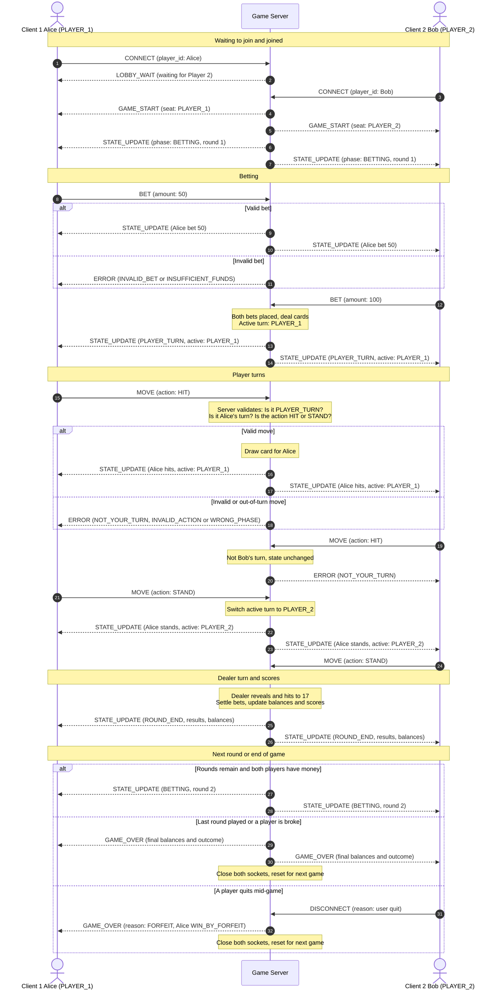
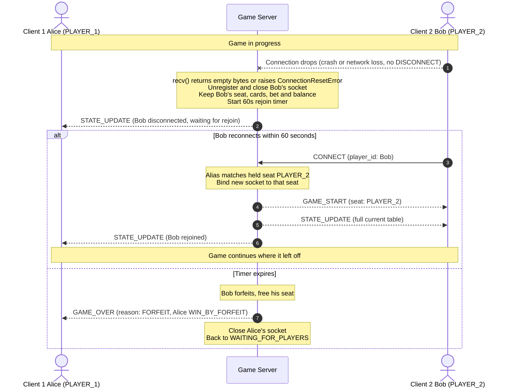

# Server Concurrency & Game Behavior Design — CS457 Blackjack

**Author:** Christopher Aidan Mills
**Course:** CS 457 — Computer Networks
**Sprint:** 2 — Game Behavior & Server Concurrency Architecture Design

This document describes how the Blackjack server handles both clients at once, keeps the game state consistent, enforces turns, and keeps both players' screens in sync. It builds on the Sprint 1 specs: [`protocol_blueprint.md`](protocol_blueprint.md) (messages and framing) and [`fsm_specification.md`](fsm_specification.md) (game state machine).

---

## 1. Concurrency Model: Non-Blocking I/O with `selectors`

The server uses **Option B: non-blocking I/O multiplexing** with Python's `selectors` module.

- There is **one thread**, which runs an event loop.
- The listening socket and every client socket are set to non-blocking (`sock.setblocking(False)`) and registered with one `selectors.DefaultSelector()`.
- Each pass of the loop calls `sel.select()`, which returns only the sockets that are ready to read or write. The server handles those and goes back to waiting. It never sits blocked on a single client.

**Why `selectors` instead of threads?** Blackjack is turn-based: only one player can act at a time, and the dealer acts after both players. There is no real parallel work, so threads would only add risk (two threads changing the game state at once) and the need for locks. With one event loop, only one piece of code runs at a time, so the game state cannot be corrupted by two clients acting simultaneously.

---

## 2. Connection Lifecycle

### 2.1 Startup
The server creates a TCP socket on port `5457`, sets `SO_REUSEADDR`, calls `bind()` and `listen()`, makes it non-blocking, and registers it with the selector for `EVENT_READ`. The FSM starts in `WAITING_FOR_PLAYERS`.

### 2.2 Accept
When the listening socket is readable, a client is connecting. The server calls `accept()`, sets the new socket to non-blocking, creates a small record for it (socket, address, input buffer, output buffer, seat, alias), and registers it for `EVENT_READ`. At this point it is connected but not yet a player.

### 2.3 Client registration
The client's first message must be `CONNECT`.
- First valid `CONNECT` → the socket is bound to seat `PLAYER_1` and receives `LOBBY_WAIT`.
- Second valid `CONNECT` → the socket is bound to `PLAYER_2`, each player receives `GAME_START` with their own seat, and the game moves to `BETTING`.
- Alias already in use → `ERROR NAME_TAKEN`. Table already full → `ERROR LOBBY_FULL`, then that socket is closed.

From then on the server identifies a player **by their socket**, not by the `player_id` inside the message, so one client cannot pretend to be the other.

### 2.4 Servicing the game
- **Reading:** When a client socket is readable, the server calls `recv(4096)` and appends the bytes to that client's buffer. It then pulls out every complete newline-terminated JSON message (handles messages that arrive split or combined, as described in the protocol blueprint) and passes each one, in order, to the game state machine.
- **Writing:** Outgoing messages are added to that client's output buffer and sent with non-blocking `send()`. If the OS can't take all the bytes right away, the rest stays in the buffer and the socket is registered for `EVENT_WRITE` until the buffer is empty. This way a slow client never holds up the server or the other player.

### 2.5 Teardown
A connection ends in one of two ways, and the server treats them differently:

| How it ends | Detected by | What the server does |
|---|---|---|
| **Intentional quit** | Client sends `DISCONNECT` | Unregister and close the socket. During a game the player forfeits, and the other player gets `GAME_OVER` (`reason: FORFEIT`). In the lobby the seat is just freed. |
| **Unexpected drop** (crash, closed window, network loss) | `recv()` returns `b""` without a `DISCONNECT`, or a send/receive raises `ConnectionResetError` / `BrokenPipeError` / `TimeoutError` | Unregister and close the socket, but **keep the player's seat and game state** and wait for them to rejoin (Section 2.6). In the lobby the seat is just freed, since no game has started. |

In both cases the socket is always unregistered from the selector **before** it is closed.

At the end of a normal game, after `GAME_OVER` is sent, both sockets are closed and the FSM goes back to `WAITING_FOR_PLAYERS` for the next pair of players.

### 2.6 Rejoining after an unexpected disconnect
When a player drops unexpectedly during a game, the server saves their place instead of ending the game:

1. **Hold the seat.** The seat stays assigned to that alias and everything about the player is kept in server memory: cards, bet, balance, and scores. Only the socket is removed. The player is marked `connected: false` and a rejoin timer starts (`REJOIN_TIMEOUT = 60` seconds).
2. **Tell the other player.** A `STATE_UPDATE` is broadcast with `last_event: "Bob disconnected, waiting 60s for him to rejoin"`.
3. **Pause only when needed.** The other player can keep playing their own turn. When the game needs input from the missing player (their bet or their turn), it waits. Any `MOVE`/`BET` from the other player during that wait still gets the normal `NOT_YOUR_TURN` / `WRONG_PHASE` errors.
4. **Rejoin.** The player reconnects and sends `CONNECT` with the **same alias**. Because that alias matches a held seat, the server binds the new socket to the old seat instead of returning `NAME_TAKEN`. It sends that player `GAME_START` (their seat and the table rules) followed by a `STATE_UPDATE` snapshot of the current table. Every `STATE_UPDATE` is a full snapshot, so this one message is enough for the client to redraw everything. The other player gets a `STATE_UPDATE` with `last_event: "Bob rejoined"`, and the game continues where it left off.
5. **Timeout.** If the player has not rejoined within 60 seconds, the server treats it as a forfeit, exactly like a `DISCONNECT`. If **both** players are disconnected and neither returns in time, the game is cleaned up with no one to notify.

The saved state lives in server memory, so it survives a client disconnect but not a server restart. Handling a server restart is out of scope for this project.

### 2.7 Event loop sketch

```python
sel = selectors.DefaultSelector()
sel.register(listen_sock, selectors.EVENT_READ, data=None)

while True:
    for key, mask in sel.select(timeout=1.0):
        if key.data is None:
            accept_client(key.fileobj)          # new connection
        else:
            client = key.data
            if mask & selectors.EVENT_READ:
                read_from_client(client)        # recv, extract messages, pass to FSM
            if mask & selectors.EVENT_WRITE:
                write_to_client(client)         # send whatever is in its output buffer
```

---

## 3. Thread Safety / State Isolation

Because there is only one thread, no `threading.Lock` is needed. Safety comes from two rules:

1. **Each event is handled completely before the next one starts.** When a message is processed, the server validates it, updates the game state, and queues the resulting updates for both players, all before going back to `select()` for the next socket.
2. **Nothing inside a handler blocks.** No `sleep()`, no blocking `recv()`/`sendall()`, no waiting for input. The only place the server waits is `sel.select()`.

### Shared resources

| Shared resource | Changed when | Why it's safe |
|---|---|---|
| Game board (dealer and player hands, deck) | Deal, `HIT`, dealer's turn | Only changed inside the FSM, one event at a time |
| Active turn (`active_player`) | `STAND`, bust, or 21 | The turn check and the turn switch happen in the same handler |
| Bets and balances | `BET`, end of round | "Already bet?" check and recording the bet happen together |
| Round scores | End of round | Updated and broadcast in the same handler |
| Connected client list / seats (including held seats) | Accept, `CONNECT`, disconnect, rejoin, rejoin timeout | Only the event loop touches it |

### Example "race" cases

| Situation | What happens |
|---|---|
| Both players send `MOVE` at the same moment | The server handles them one after the other. The first is applied; the second is checked against the updated state and gets `ERROR NOT_YOUR_TURN`. |
| Both players send `BET` at the same moment | Handled one after the other. The second bet sees the first is already recorded and triggers the deal exactly once. |
| A message arrives while the dealer is playing | The dealer's turn runs start to finish inside one handler, so the message waits in the buffer and is handled afterwards. |
| A player's connection drops mid-game | The socket is closed once, the seat and game state are kept for 60 seconds, and the other player is told. The server keeps running. |
| A player rejoins while the other player is mid-move | The rejoin is handled as one event: the seat is re-bound and the snapshot sent before the next message is processed, so the rejoining player can't miss an update. |

---

## 4. Turn Enforcement & Move Validation

When a `MOVE` arrives, the server checks, in order:

1. Is the message valid JSON with the right fields? Otherwise → `ERROR MALFORMED_MESSAGE`.
2. Is the game in `PLAYER_TURN`? Otherwise → `ERROR WRONG_PHASE`.
3. Is the sender's seat the `active_player`? Otherwise → `ERROR NOT_YOUR_TURN`.
4. Is the action `HIT` or `STAND`? Otherwise → `ERROR INVALID_ACTION`.

Errors go **only to the player who sent the bad message**, and nothing in the game changes. Only after all checks pass does the server draw a card or record the stand, switch turns if needed, and broadcast the new state. Bets go through similar checks (`WRONG_PHASE`, `INVALID_BET`, `INSUFFICIENT_FUNDS`).

---

## 5. Broadcasting State to Both Clients

After every change to the game (a bet, a hit or stand, each dealer card, end of round), the server builds **one** `STATE_UPDATE` containing the full table: phase, round, whose turn it is, all hands, balances, and bets. It encodes that message once and adds the same bytes to both players' output buffers in the same step, before handling any other message.

This means:
- Both players always get the **same** snapshot of the table.
- Both get it at the same point in the game, before either can act on newer information.
- Both receive updates in the same order (TCP keeps order within each connection).
- If sending to one player fails, that player is disconnected, but the other still receives the update.

---

## 6. Score & Leaderboard Synchronization

**Storage.** The FSM keeps a small score record per seat:

```python
scores = {
    "PLAYER_1": {"alias": "Alice", "balance": 500, "wins": 0, "losses": 0, "pushes": 0},
    "PLAYER_2": {"alias": "Bob",   "balance": 500, "wins": 0, "losses": 0, "pushes": 0},
}
```

Balances start at `starting_balance` when the game starts. A bet is taken out of the balance when it's placed.

**End of round.** In `ROUND_END` the server settles each player using the rules in the FSM spec (win, loss, push, blackjack), updates their balance and win/loss/push count, and then broadcasts a `STATE_UPDATE` with `phase: "ROUND_END"`. That update contains each player's new `balance` and their `result` for the round, so both screens show the same updated standings at the same time. The leaderboard is simply the players ordered by balance.

**End of game.** `GAME_OVER` is sent to both players with each player's final balance, net gain or loss, and outcome (`WIN`, `LOSS`, `DRAW`, or forfeit). The scores are cleared when the server resets for the next game.

---

## 7. Sequence Diagrams

### 7.1 Full game flow



This diagram uses all nine message types in the protocol: `CONNECT`, `LOBBY_WAIT`, `GAME_START`, `BET`, `MOVE`, `STATE_UPDATE`, `ERROR`, `DISCONNECT` and `GAME_OVER`.

**Walkthrough:**
1. **Waiting / joined (1–7).** Alice connects and is told to wait. When Bob connects, each player gets `GAME_START` with their seat, and both get the opening `STATE_UPDATE` for betting.
2. **Betting (8–14).** Each bet is checked. A valid bet is broadcast to both players; an invalid one gets an `ERROR` sent only to the sender. Once both bets are in, cards are dealt and both players see that it's Alice's turn.
3. **Moves (15–24).** Alice's `HIT` is validated (phase, turn, action) before anything changes. A valid move is broadcast to both; an invalid one returns an `ERROR`. Bob trying to move during Alice's turn gets `NOT_YOUR_TURN` and the game is unchanged. When Alice stands, the turn switches to Bob and both players are told.
4. **Dealer and scores (25–26).** After Bob's turn, the dealer plays, bets are settled, and the updated balances and results are broadcast to both players.
5. **Next round, game over, or forfeit (27–32).** Either both players get the next betting round, both get `GAME_OVER` with the final results, or, if a player sends `DISCONNECT` mid-game, the other player gets `GAME_OVER` as a forfeit win. In the last two cases the server closes the sockets and resets.

### 7.2 Disconnect and rejoin



If Bob's connection drops without a `DISCONNECT`, the server closes his socket but keeps his seat and all of his game state, and tells Alice it is waiting. If Bob reconnects with the same alias within 60 seconds, he is put back in his seat and sent `GAME_START` plus a full `STATE_UPDATE`, so his screen is restored, and Alice is told he is back. If he does not return in time, it becomes a forfeit and Alice receives `GAME_OVER`. (An intentional `DISCONNECT` skips the wait and forfeits right away, as shown at the end of diagram 7.1.)
