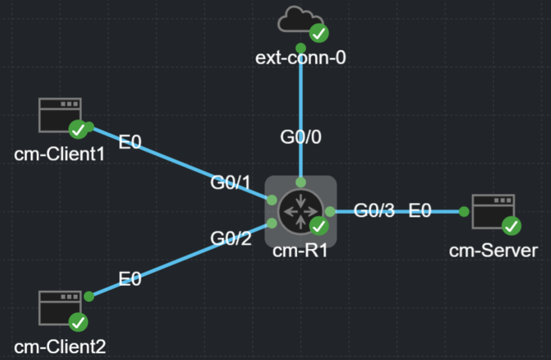
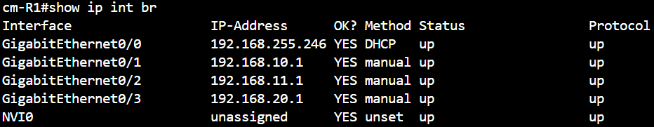
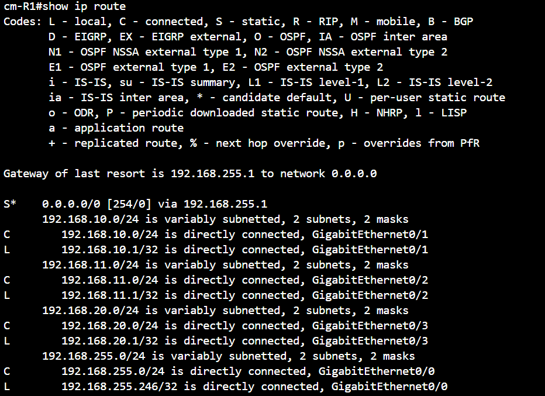
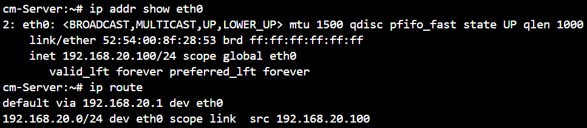
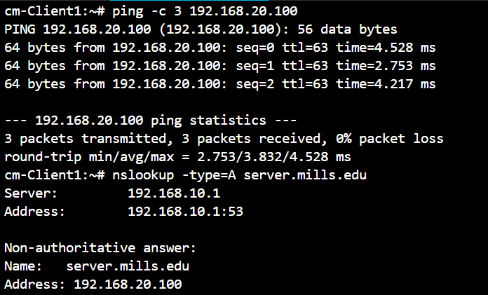
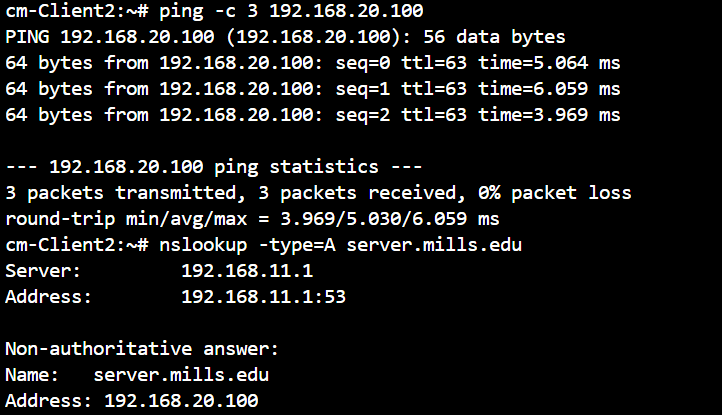
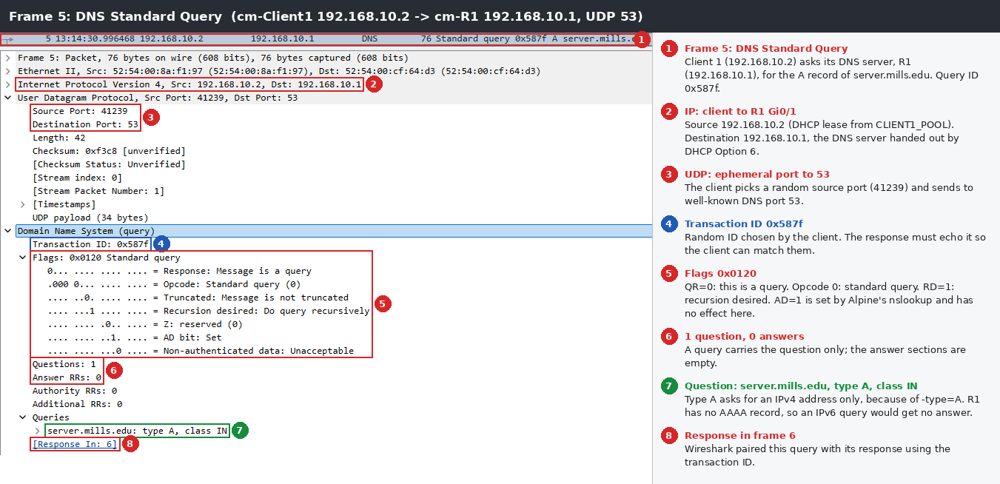
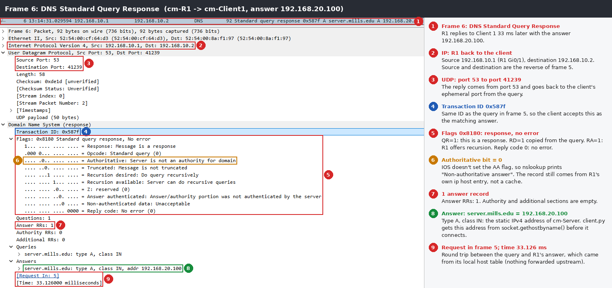
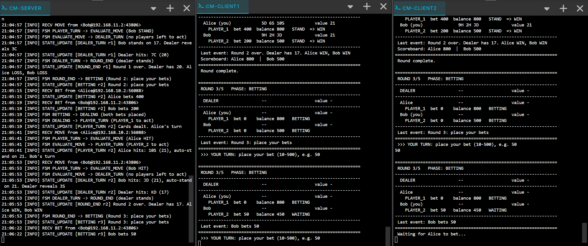

# Sprint 4 — Network Verification Report

**Author:** Christopher Aidan Mills
**Course:** CS 457 — Computer Networks
**Sprint:** 4 — CML 1-Router Network Topology & Infrastructure Deployment

This report documents the Cisco Modeling Labs (CML) network that hosts the
two-player Blackjack game from Sprints 1–3. A single Cisco IOSv router
(`cm-R1`) connects three subnets, gives the two client nodes their addresses by
DHCP, and is the DNS server for `server.mills.edu`. Every output below was
captured from the running lab on Nov 20, 2026.

| Deliverable | File |
|---|---|
| CML topology export | [`sprint_4_topology.yaml`](sprint_4_topology.yaml) |
| Wireshark DNS capture | [`sprint_4_dns_lookup.pcap`](sprint_4_dns_lookup.pcap) |
| R1 configuration | [`sprint_4_configs/cm-R1.cfg`](sprint_4_configs/cm-R1.cfg) |
| Day-0 boot configs for each node | [`sprint_4_configs/`](sprint_4_configs/) |
| This report | `sprint_4_network_report.md` |

---

## 1. Topology



*CML canvas with all five nodes running. Labels show the interfaces at each
end of every link: Client1 E0 ↔ R1 G0/1, Client2 E0 ↔ R1 G0/2, R1 G0/3 ↔
Server E0, and R1 G0/0 ↔ the External Connector.*

### 1.1 Addressing plan

| Node | Interface | IP address | Gateway | DNS | Assigned by |
|---|---|---|---|---|---|
| `cm-R1` | Gi0/0 | 192.168.255.246/24 | 192.168.255.1 | 192.168.255.1 | DHCP from `ext-conn-0` |
| `cm-R1` | Gi0/1 | 192.168.10.1/24 | — | — | static |
| `cm-R1` | Gi0/2 | 192.168.11.1/24 | — | — | static |
| `cm-R1` | Gi0/3 | 192.168.20.1/24 | — | — | static |
| `cm-Client1` | eth0 | 192.168.10.2/24 | 192.168.10.1 | 192.168.10.1 | R1 `CLIENT1_POOL` |
| `cm-Client2` | eth0 | 192.168.11.2/24 | 192.168.11.1 | 192.168.11.1 | R1 `CLIENT2_POOL` |
| `cm-Server` | eth0 | 192.168.20.100/24 | 192.168.20.1 | 192.168.20.1 | static |

All three LAN subnets are directly connected to R1, so they appear in its
routing table as connected (`C`) routes and no static routes between subnets
are needed (§3.2).

---

## 2. Configuration

### 2.1 Router `cm-R1`

The full configuration is in
[`sprint_4_configs/cm-R1.cfg`](sprint_4_configs/cm-R1.cfg) (day-0 config). The
running config is also embedded in `sprint_4_topology.yaml`. In summary:

- **Interfaces:** Gi0/1, Gi0/2 and Gi0/3 are the gateways for Subnets A, B and
  C. Gi0/0 takes its address by DHCP from the External Connector.
- **DHCP:** `ip dhcp excluded-address` keeps `.1` (the gateway) out of each
  pool. `CLIENT1_POOL` and `CLIENT2_POOL` hand out an address, Option 3
  (default router) and Option 6 (DNS server = the router's own interface). R1
  picks the pool whose `network` matches the interface the DHCPDISCOVER
  arrived on. That is why Client 1 got 192.168.10.2 and Client 2 got
  192.168.11.2 (§3.3).
- **DNS:** `ip dns server` turns on the IOS DNS responder on UDP/TCP 53, and
  `ip host server.mills.edu 192.168.20.100` is the A record. Other names are
  forwarded to the name server R1 learned on Gi0/0 (192.168.255.1).
- **NAT:** Gi0/0 is `ip nat outside`, and the three LAN interfaces are
  `ip nat inside`. ACL 1 matches all three /24 subnets (wildcard `0.0.0.255`)
  for PAT (`overload`) so the nodes can reach package mirrors and GitHub.
- `write memory` saves the configuration to NVRAM.

**Troubleshooting note.** At first `apk update` on the clients failed (`TLS:
unspecified error`, then `Socket not connected` over HTTP), even though DNS
for `dl-cdn.alpinelinux.org` resolved. DNS still worked because R1 resolves
names itself from its outside address, which doesn't go through NAT. The cause
was a typo in the NAT ACL: the wildcard was `0.0.0.225` instead of
`0.0.0.255`. Wildcard 225 (`11100001`) requires bits 1–4 of the last octet to
be 0, so hosts `.2` (`00000010`) and `.100` (`01100100`) never matched, and
their traffic left R1 untranslated. Replacing the ACL with `0.0.0.255` entries
fixed internet access for all three nodes.

### 2.2 Game server `cm-Server` (Alpine Linux)

The node's boot config
([`sprint_4_configs/cm-Server.cfg`](sprint_4_configs/cm-Server.cfg)) applies
the static address on every boot:

```sh
ip link set eth0 up
ip addr flush dev eth0
ip addr add 192.168.20.100/24 dev eth0
ip route add default via 192.168.20.1
echo "nameserver 192.168.20.1" > /etc/resolv.conf
```

The default route matters: without it, a client's request from 192.168.10.x
or 192.168.11.x reaches the server, but the reply has no route back.

### 2.3 Clients `cm-Client1` / `cm-Client2` (Alpine Linux)

Both clients request a lease at boot
([`cm-Client1.cfg`](sprint_4_configs/cm-Client1.cfg),
[`cm-Client2.cfg`](sprint_4_configs/cm-Client2.cfg)). `-b` keeps `udhcpc`
retrying in the background until R1 answers:

```sh
ip link set eth0 up
udhcpc -i eth0 -b
```

---

## 3. Router verification

### 3.1 `show ip interface brief`

All four GigabitEthernet interfaces are up/up. Gi0/0 got 192.168.255.246 from
the External Connector by DHCP. `NVI0` is the NAT virtual interface that IOS
creates for NAT.

```text
cm-R1#show ip int br
Interface              IP-Address      OK? Method Status                Protocol
GigabitEthernet0/0     192.168.255.246 YES DHCP   up                    up
GigabitEthernet0/1     192.168.10.1    YES manual up                    up
GigabitEthernet0/2     192.168.11.1    YES manual up                    up
GigabitEthernet0/3     192.168.20.1    YES manual up                    up
NVI0                   unassigned      YES unset  up                    up
```



### 3.2 `show ip route`

There are three connected (`C`) routes, one per LAN subnet, plus the
192.168.255.0/24 link to the External Connector. The default route
(`S* 0.0.0.0/0 via 192.168.255.1`) was learned through DHCP on Gi0/0 and sends
internet-bound traffic out the NAT interface. There are no static routes
between the LAN subnets.

```text
cm-R1#show ip route
Codes: L - local, C - connected, S - static, R - RIP, M - mobile, B - BGP
       D - EIGRP, EX - EIGRP external, O - OSPF, IA - OSPF inter area
       N1 - OSPF NSSA external type 1, N2 - OSPF NSSA external type 2
       E1 - OSPF external type 1, E2 - OSPF external type 2
       i - IS-IS, su - IS-IS summary, L1 - IS-IS level-1, L2 - IS-IS level-2
       ia - IS-IS inter area, * - candidate default, U - per-user static route
       o - ODR, P - periodic downloaded static route, H - NHRP, l - LISP
       a - application route
       + - replicated route, % - next hop override, p - overrides from PfR

Gateway of last resort is 192.168.255.1 to network 0.0.0.0

S*    0.0.0.0/0 [254/0] via 192.168.255.1
      192.168.10.0/24 is variably subnetted, 2 subnets, 2 masks
C        192.168.10.0/24 is directly connected, GigabitEthernet0/1
L        192.168.10.1/32 is directly connected, GigabitEthernet0/1
      192.168.11.0/24 is variably subnetted, 2 subnets, 2 masks
C        192.168.11.0/24 is directly connected, GigabitEthernet0/2
L        192.168.11.1/32 is directly connected, GigabitEthernet0/2
      192.168.20.0/24 is variably subnetted, 2 subnets, 2 masks
C        192.168.20.0/24 is directly connected, GigabitEthernet0/3
L        192.168.20.1/32 is directly connected, GigabitEthernet0/3
      192.168.255.0/24 is variably subnetted, 2 subnets, 2 masks
C        192.168.255.0/24 is directly connected, GigabitEthernet0/0
L        192.168.255.246/32 is directly connected, GigabitEthernet0/0
```



### 3.3 `show ip dhcp binding`

There is one automatic lease from each pool. Each client got the first
address after the excluded gateway `.1`. The Client-ID is `01` (Ethernet)
followed by the client's MAC address. `52:54:00:8a:f1:97` is the same MAC
that sends the DNS query in the capture (§5).

```text
cm-R1#show ip dhcp binding
Bindings from all pools not associated with VRF:
IP address          Client-ID/              Lease expiration        Type
                    Hardware address/
                    User name
192.168.10.2        0152.5400.8af1.97       Nov 21 2026 07:49 PM    Automatic
192.168.11.2        0152.5400.dcfe.95       Nov 21 2026 07:50 PM    Automatic
```

## 4. Endpoint verification

### 4.1 Game server: `ip addr show eth0` and `ip route`

The server has the static address 192.168.20.100/24 and a default route
through R1's Gi0/3 (192.168.20.1). That route is what carries its replies
back to the client subnets.

```text
cm-Server:~# ip addr show eth0
2: eth0: <BROADCAST,MULTICAST,UP,LOWER_UP> mtu 1500 qdisc pfifo_fast state UP qlen 1000
    link/ether 52:54:00:8f:28:53 brd ff:ff:ff:ff:ff:ff
    inet 192.168.20.100/24 scope global eth0
       valid_lft forever preferred_lft forever
cm-Server:~# ip route
default via 192.168.20.1 dev eth0
192.168.20.0/24 dev eth0 scope link  src 192.168.20.100
```



### 4.2 Client 1 → game server

The ping crosses subnets: each reply arrives with `ttl=63`, one less than
Alpine's default of 64. That is one router hop, through R1 from
192.168.20.0/24 to 192.168.10.0/24. The lookup is answered by 192.168.10.1,
the DNS server Client 1 got through DHCP Option 6.

```text
cm-Client1:~# ping -c 3 192.168.20.100
PING 192.168.20.100 (192.168.20.100): 56 data bytes
64 bytes from 192.168.20.100: seq=0 ttl=63 time=4.528 ms
64 bytes from 192.168.20.100: seq=1 ttl=63 time=2.753 ms
64 bytes from 192.168.20.100: seq=2 ttl=63 time=4.217 ms

--- 192.168.20.100 ping statistics ---
3 packets transmitted, 3 packets received, 0% packet loss
round-trip min/avg/max = 2.753/3.832/4.528 ms
cm-Client1:~# nslookup -type=A server.mills.edu
Server:         192.168.10.1
Address:        192.168.10.1:53

Non-authoritative answer:
Name:   server.mills.edu
Address: 192.168.20.100
```



`nslookup` prints "Non-authoritative answer" because the IOS DNS server does
not set the Authoritative Answer (AA) bit in its responses (see flags
`0x8180` in §5). The answer still comes from R1's own `ip host` record, not
from a cache or an upstream server.

### 4.3 Client 2 → game server

Client 2's results match Client 1's: 0% loss with `ttl=63` (one hop
through R1). Its lookup is answered by 192.168.11.1, R1's Gi0/2 address,
which DHCP gave Client 2 as its DNS server from `CLIENT2_POOL`.

```text
cm-Client2:~# ping -c 3 192.168.20.100
PING 192.168.20.100 (192.168.20.100): 56 data bytes
64 bytes from 192.168.20.100: seq=0 ttl=63 time=5.064 ms
64 bytes from 192.168.20.100: seq=1 ttl=63 time=6.059 ms
64 bytes from 192.168.20.100: seq=2 ttl=63 time=3.969 ms

--- 192.168.20.100 ping statistics ---
3 packets transmitted, 3 packets received, 0% packet loss
round-trip min/avg/max = 3.969/5.030/6.059 ms
cm-Client2:~# nslookup -type=A server.mills.edu
Server:         192.168.11.1
Address:        192.168.11.1:53

Non-authoritative answer:
Name:   server.mills.edu
Address: 192.168.20.100
```



---

## 5. Wireshark DNS capture

**File:** [`sprint_4_dns_lookup.pcap`](sprint_4_dns_lookup.pcap). It was
captured on the `cm-Client1` ↔ `cm-R1` link (Gi0/1) while running
`nslookup -type=A server.mills.edu` on `cm-Client1`. In Wireshark, use the
display filter `dns`.

**Frame 5: DNS Standard Query** (Client 1 → R1, UDP 41239 → 53)



**Frame 6: DNS Standard Query Response** (R1 → Client 1, UDP 53 → 41239,
answer 192.168.20.100)



The unannotated originals are
[`dns_query.png`](screenshots/dns_query.png) and
[`dns_standard_response.png`](screenshots/dns_standard_response.png).

The capture has 9 frames. **Frames 5 and 6 are the DNS exchange.** The others
are background traffic on the link: Cisco Ethernet loopback keepalives
(frames 1–3 and 7, EtherType `0x9000`, sent every 10 s), a CDP announcement
from `cm-R1` (frame 4), and the ARP request/reply pair the client sends after
the lookup to refresh its entry for the gateway (frames 8–9).

### 5.1 Annotated exchange

| | Frame 5 — **DNS Standard Query** | Frame 6 — **DNS Standard Query Response** |
|---|---|---|
| Time (UTC) | 20:14:30.996468 | 20:14:31.029594 (+33 ms) |
| Ethernet | `52:54:00:8a:f1:97` → `52:54:00:cf:64:d3` | `52:54:00:cf:64:d3` → `52:54:00:8a:f1:97` |
| IP | **192.168.10.2 → 192.168.10.1**, TTL 64 | **192.168.10.1 → 192.168.10.2**, TTL 255 |
| UDP | src port 41239 → dst port **53** | src port **53** → dst port 41239 |
| Transaction ID | **0x587f** | **0x587f** (same ID pairs the response with the query) |
| Flags | `0x0120`: QR=0 (query), Opcode 0 (standard), RD=1 (recursion desired), AD=1 | `0x8180`: QR=1 (response), Opcode 0, AA=0, RD=1, RA=1 (recursion available), RCODE 0 (no error) |
| Counts | 1 question, 0 answers | 1 question, **1 answer** |
| Question | `server.mills.edu`, type **A** (1), class IN | same question echoed back |
| Answer | — | `server.mills.edu`, type **A**, class IN, TTL 10 s, address **192.168.20.100** |

### 5.2 What the capture shows

1. **Query (frame 5).** Client 1 sends one UDP datagram from an ephemeral
   port (41239) to port 53 on 192.168.10.1, the DNS server it got through
   DHCP Option 6. It asks only for the **A** record of `server.mills.edu`.
   Because of `-type=A`, there is no AAAA query. R1 only has an IPv4 record,
   so an AAAA query would get an empty answer.
2. **Response (frame 6).** R1 answers 33 ms later, from port 53 back to port
   41239, with the same transaction ID `0x587f`. RCODE 0 means no error, and
   the response carries one answer.
3. **Answer.** The A record is **192.168.20.100**, the static address of
   `cm-Server`, with a 10-second TTL (the IOS default for `ip host`
   entries). This is the address `client.py` gets from
   `socket.gethostbyname("server.mills.edu")` before it opens its TCP
   connection to the game server.
4. The answer is local. R1 answers from its host table, and no packet goes
   out Gi0/0 to an upstream server. The only difference from a textbook
   authoritative response is the AA flag, which IOS leaves at 0 (§4.2).

---

## 6. Running the game on the network

With NAT working, every node can install packages and clone the repository.
The game server runs the Sprint 3 server, and each client connects by
hostname, so one connection uses the whole path: DNS → routing → TCP.

```sh
# all three nodes
sudo apk update && sudo apk add git python3 && sync
git clone https://github.com/chris-mills03/CS457-BlackJack-mills.git
cd CS457-BlackJack-mills

# cm-Server
python3 server.py -p 5457

# cm-Client1 / cm-Client2
python3 client.py -i server.mills.edu -p 5457 -n Alice    # Bob on Client 2
```



*Left: `cm-Server` (192.168.20.100). Middle: `cm-Client1` (Alice). Right:
`cm-Client2` (Bob). The game is at the start of round 3 of 5.*

What the screenshot shows:

- **Both clients reach the server across subnets.** The server log receives
  messages from `Alice@192.168.10.2` (Subnet A) and `Bob@192.168.11.2`
  (Subnet B). Each client used DNS to resolve `server.mills.edu` to
  192.168.20.100, and R1 routed the TCP connection from the client's subnet
  to Subnet C.
- **The Sprint 1 FSM runs over the network.** The log shows the full cycle
  for round 2:
  `BETTING -> DEALING -> PLAYER_TURN -> EVALUATE_MOVE -> DEALER_TURN -> ROUND_END -> BETTING`.
  Both players hit to exactly 21 and auto-stood, which follows the FSM
  spec's turn rule.
- **Both players see the same state.** Each client draws the same table from
  the same `STATE_UPDATE`. After round 2, both show "Alice WIN, Bob WIN" and
  the scoreboard Alice 800 | Bob 500. In round 3, Bob's bet of 50 appears on
  both screens, and each client prompts the right player ("YOUR TURN" for
  Alice, "Waiting for Alice to bet..." for Bob).

---

## 7. Summary

| Requirement | Evidence | Status |
|---|---|---|
| One router connects 192.168.10.0/24, 192.168.11.0/24 and 192.168.20.0/24 | §1, §3.1, §3.2 | ✅ |
| R1 issues IP, gateway and DNS to both clients from separate pools | §3.3, §4.2, §4.3 | ✅ |
| Server has static 192.168.20.100/24 with default gateway 192.168.20.1 | §2.2, §4.1 | ✅ |
| DNS resolves `server.mills.edu` → 192.168.20.100 (pcap + report) | §4.2, §4.3, §5 | ✅ |
| Both clients ping the server across subnets with no loss | §4.2, §4.3 | ✅ |
| Deliverables committed with `sprint_4_` names | Table at the top | after push |
